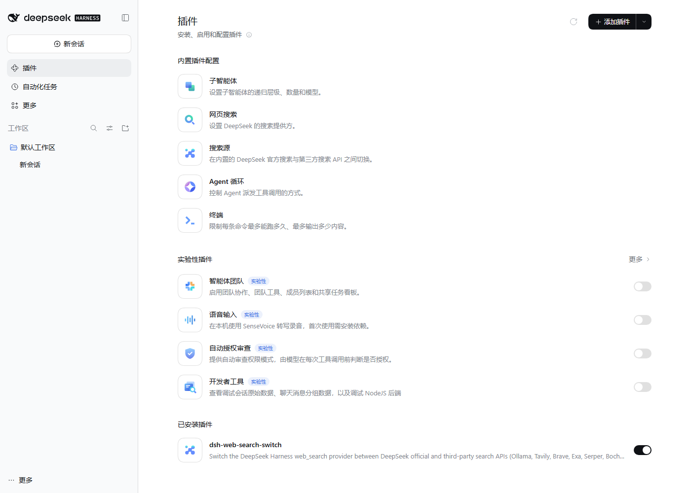
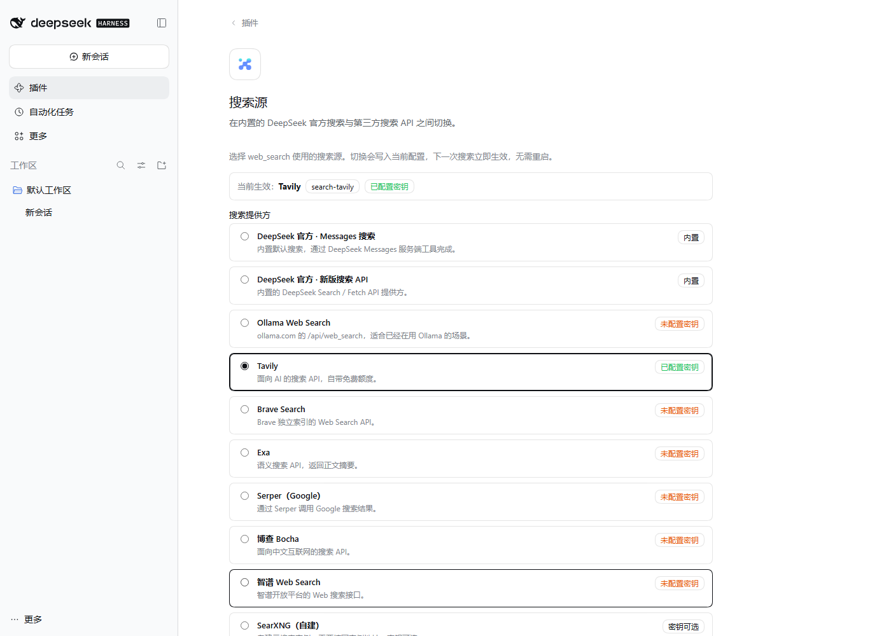

# dsh-web-search-switch

> 在 DeepSeek Harness 桌面端 / Web 端里，用设置页面一键切换 `web_search` 的搜索源：官方 DeepSeek、Ollama、Tavily、Brave、Exa、Serper、博查、智谱、SearXNG。



## 它解决什么问题

DSH 自带的 `web_search` 只走 DeepSeek 官方搜索（`deepseek-official`，需要 `DEEPSEEK_API_KEY` 或 DeepSeek 账号）。社区插件 [`dsh-web-search-ollama`](https://github.com/sryimnoob123/dsh-web-search-ollama) 能让它改走 Ollama，但需要手改 `cordis.patch.yml`、设置全局环境变量、禁用官方搜索并重启，而且只能二选一。

本插件把“搜索源”变成设置页里的一个选项：

- **一个页面切换**：在侧边栏「插件 → 内置插件配置 → 搜索源」或「设置 → 内置插件 → 搜索源」里选择，保存后下一次搜索立即生效，无需重启。
- **官方与第三方并存**：随时切回 DeepSeek 官方（Messages 搜索或新版搜索 API），不需要卸载插件。
- **密钥不落配置文件**：API Key 通过 DSH 的凭据服务保存（`.credentials.yaml`），设置文件里只有凭据引用；页面只显示“已配置/未配置”。
- **不会静默回落**：选中的搜索源缺少密钥时，`web_search` 会返回明确的错误，告诉模型和用户缺哪个 Key、去哪里配置。

## 支持的搜索源

| 设置页选项 | Provider id | 默认凭据引用 | 默认端点 |
| --- | --- | --- | --- |
| DeepSeek 官方 · Messages 搜索 | `deepseek-official` | `DEEPSEEK_API_KEY`（或 DeepSeek 账号登录） | 内置 |
| DeepSeek 官方 · 新版搜索 API | `deepseek-search-api` | `DEEPSEEK_API_KEY` | 内置 |
| Ollama Web Search | `search-ollama` | `OLLAMA_API_KEY` | `https://ollama.com/api/web_search` |
| Tavily | `search-tavily` | `TAVILY_API_KEY` | `https://api.tavily.com/search` |
| Brave Search | `search-brave` | `BRAVE_API_KEY` | `https://api.search.brave.com/res/v1/web/search` |
| Exa | `search-exa` | `EXA_API_KEY` | `https://api.exa.ai/search` |
| Serper（Google） | `search-serper` | `SERPER_API_KEY` | `https://google.serper.dev/search` |
| 博查 Bocha | `search-bocha` | `BOCHA_API_KEY` | `https://api.bochaai.com/v1/web-search` |
| 智谱 Web Search | `search-zhipu` | `ZHIPU_API_KEY` | `https://open.bigmodel.cn/api/paas/v4/web_search` |
| SearXNG（自建） | `search-searxng` | `SEARXNG_API_KEY`（可选） | 你的实例地址 + `/search` |

## 安装

把 `<profile>` 换成你的 profile 目录：桌面端一般是 `%DSH_HOME%\profiles\desktop`（默认 `C:\Users\<你>\.dsh\profiles\desktop`），Web 端是 `dsh web` 使用的那个 profile。

### 方式一：从 GitHub 安装

```powershell
cd <profile>
pnpm add github:xiaokang6/dsh-web-search-switch
```

然后把 `dsh-web-search-switch` 加进 profile `package.json` 的 `dsh.profile.bundles`：

```json
"dsh": { "profile": { "bundles": ["...原有 bundle...", "dsh-web-search-switch"] } }
```

也可以直接用 DSH 插件页的「添加插件」填仓库地址，由插件管理器完成安装与启用。

### 方式二：本地目录（开发 / link）

1. 把本仓库作为本地依赖加入 profile：

   ```powershell
   node scripts/install.mjs --profile <profile>
   ```

   脚本会写入 `package.json` 的 `dependencies`（`link:` 绝对路径）和 `dsh.profile.bundles`，并保留原文件内容（UTF-8 无 BOM）。加 `--dry-run` 只检查不写入。

2. 安装依赖：

   ```powershell
   cd <profile>
   pnpm install
   ```

   （DSH 自带 pnpm 时，用启动器提供的 pnpm 即可。）

### 最后一步：重启

重启 DeepSeek Harness。之后打开侧边栏「插件」，在「内置插件配置」里会多出 **搜索源** 卡片。

> 只在第一次安装时需要重启；之后切换搜索源、改密钥、改结果数都在设置页完成并立即生效。

## 使用

1. 侧边栏「插件」→「内置插件配置」→「搜索源」（也可以从「设置 → 内置插件 → 搜索源」进入）。
2. 选中一个搜索源。第三方服务会显示 API Key 输入框，把密钥粘贴进去。
3. 点「保存」。页面顶部「当前生效」会更新，下一次 `web_search` 就用新的搜索源。
4. 想切回官方：选中「DeepSeek 官方 · Messages 搜索」→ 保存。



### 高级设置

| 字段 | 默认 | 说明 |
| --- | --- | --- |
| 每次结果数 | 5 | 1–20，最终仍受 `web_search` 工具自己的结果上限约束。 |
| 超时（毫秒） | 20000 | 5000–120000；超时返回可读错误，不会卡住搜索。 |
| 接口地址 | 各服务默认值 | 例如走代理或镜像时修改；SearXNG 必填实例地址。留空保存会恢复默认。 |

每个第三方搜索源的凭据引用名也可以改（默认见上表）：在 profile 的 `cordis.patch.yml` 里给 `web-search-switch` 行加 `ollamaApiKeyEnv` 等字段。设置页会按新的引用名读写密钥。

## 工作原理（简要）

- 宿主侧（`lib/index.js`）在 `ctx.web` 上注册 8 个搜索 provider，id 统一带 `search-` 前缀，避免与内置 provider（`deepseek-official`、`deepseek-search-api`）以及 `dsh-web-search-ollama` 的 `ollama` 冲突。
- 设置页把选中的 provider id 写进 **`web` 条目的 `searchProvider`**（DSH 官方设置页的同一机制），配置改动由 config-editor 立即应用。
- 密钥写入 DSH 凭据服务，provider 每次搜索时重新解析，因此轮换密钥无需重启。
- 浏览器侧（`lib/client.js`）是手写的 dsh client bundle，注册到 `plugins.item` 和 `settings.plugins.tab` 两个 slot，只依赖平台内置的 `react`。

## 与 `dsh-web-search-ollama` 的关系

- 那个插件**可以**装到桌面端：桌面端和 Web/CLI 使用同一套 profile 与 `ctx.web` seam。但它只注册一个 `ollama` provider，要靠手改 YAML、`setx` 全局环境变量、禁用官方搜索并重启来切换，不能和其他搜索源共存。
- 本插件不取代它，而是提供同类的 Ollama 接入 **加上** 官方/其他 API 的设置页切换。两者请不要同时安装：都会注册 Ollama provider（本插件用 `search-ollama`，不会 id 冲突，但设置页会出现两个 Ollama 选项）。
- 如果之前按它的 README 改过 `cordis.patch.yml`（`searchProvider: ollama`、`disabled: true`）或设置过 `DSH_WEB_SEARCH_PROVIDER`，装好本插件后请把这些覆盖删掉，让设置页成为唯一入口。

## 排错

| 现象 | 处理 |
| --- | --- |
| 保存后提示 `WEB_PROVIDER_CONFIGURED_MISSING` | `web.searchProvider` 指向的 provider 没加载：确认插件已启用（插件页开关）、profile bundle 列表包含 `dsh-web-search-switch`，然后重启。 |
| 搜索报“还没有配置 API Key（XXX_API_KEY）” | 在搜索源页面填入对应密钥并保存；或先切回官方。 |
| 搜索报 HTTP 401 / 403 | 密钥无效、过期或没有该服务的权限；在对应服务控制台确认。 |
| SearXNG 报需要实例地址 | 高级设置里填 `https://searx.example.com` 这类地址（不要带 `/search`）。 |
| 页面里看不到「搜索源」卡片 | 插件没加载：查看「已安装插件」里是否有 `dsh-web-search-switch` 且开关为开；首次安装后需要重启。 |
| 搜索超时 | 调大高级设置里的超时，或检查网络/代理。 |

## 开发与验证

- `lib/index.js`：宿主 provider pack（ESM，导入 `@deepseek-ai/schemastery`、`@deepseek-ai/dsh-web` 等宿主包）。
- `lib/client.js`：浏览器 bundle（`window.__ModuleLoader__.load` 手写 CJS，平台只提供 `react`）。
- `cordis.patch.yml`：只插入 `web-search-switch` 一行，不修改 `web.searchProvider` 的默认值。

本仓库的验证覆盖：

- 宿主：本地 mock HTTP 服务逐一对 8 个 provider 断言请求方法/鉴权头/请求体/结果映射、缺 Key、HTTP 错误、取消、非法地址。
- 客户端：真实 `lib/client.js` 在 jsdom + React 18 中挂载，模拟选择搜索源、输入密钥、保存，断言写入 `web`/本插件命名空间与凭据服务。
- 端到端：用独立 profile 启动一套 DSH Web 实例，在真实界面里切换 Tavily、保存密钥，并检查 `cordis.patch.yml` 与 `.credentials.yaml` 的落盘结果。

## License

MIT
